# OpenFlight tester guide

## What you need

- An OpenFlight unit: a Raspberry Pi 5 with all four sensors fitted.
- A screen on the Pi, or a phone or laptop on the same Wi-Fi.
- Real golf balls (not foam), and a lamp if you're indoors.
- About 10 minutes for the first setup.

> **Which enclosure?** The unit's sensor geometry is set for **the v3 enclosure (open-flight/openflight-enclosure) with the experimental radar and camera mounts**, where the camera sits directly above the IWR6843's receive (RX) antennas. You can test and send data with any other enclosure, but **tell us if yours isn't that one**: the measurements depend on exactly where the sensors sit.

## Start the unit

On the Pi, open a terminal:

```
sudo systemctl stop openflight.service        # only if your unit starts OpenFlight on boot
cd ~/openflight
git fetch origin && git checkout feat/tester-capture-pilot && git pull
ls /dev/serial/by-id/                          # find the IWR6843's "...if00-port0" entry
bash scripts/start-tester.sh --host 0.0.0.0 --iwr-static-port /dev/serial/by-id/<your ...if00-port0 entry>
```

- **OPS243 on USB rather than the GPIO pins?** Add `--radar-port /dev/ttyACM0`, or whichever port it shows.
- **Using the unit's own touchscreen instead of a phone?** Add `--on-screen`. The tester page then opens full screen on the unit by itself, once the tester is ready:

  ```
  bash scripts/start-tester.sh --on-screen --host 0.0.0.0 --iwr-static-port /dev/serial/by-id/<your ...if00-port0 entry>
  ```

Leave the terminal open; **Ctrl+C** in it stops everything. Then open the tester page:

- **On the Pi's own screen:** start with `--on-screen` (above) and it's already there.
- **From a phone or laptop:** `http://<pi address>:8765/`. Find the address with `hostname -I` on the Pi, and note the colon before `8765`.

### On the unit's own screen: one window for both

With `--on-screen`, the tester page and the scoreboard share the unit's screen and take turns in it. Each switch is one tap, and nothing restarts: the kiosk, free play and the camera keep running, and the tester page comes back where it was.

- **Kiosk view** (top right of the tester page) shows the scoreboard.
- **Tester** (top right of the scoreboard, on every tab) brings the tester page back.
- **Start free play** switches to the scoreboard by itself when the kiosk is ready, about 20 seconds later. The line under the top bar says so while you wait.
- **Stop & package** on the scoreboard brings the tester page back, where you wait for the package and tap **Done**.

Everything is touch: tap buttons, and drag the page (or a list) up and down with your finger to scroll. The pages fit the unit's 1024×600 and 800×480 screens. If everything looks too small on your screen, start with `OPENFLIGHT_KIOSK_ZOOM=1.25` in front of `bash scripts/start-tester.sh` (bigger numbers zoom more).

## Set up (once per spot)

Work down the page. Each step opens when the one before it is done, and the bar at the top says where you are. Steps 3, 4 and 6 write one setup record, `setup.json`, in your tester folder. The kiosk the page starts loads it at start. If you change the lens, the unit or the box, the steps that depended on it show as needing redoing: redo them.

**1. Tester and lens.** Type your tester ID in the box and tap **Use this ID** (or press Enter). Use the same ID every time you test, so your sessions stay together; it can have letters, numbers, dots, dashes and underscores. Tap **Indoors** or **Outdoors**, **Right-handed** or **Left-handed**, then the lens fitted to the unit (**Stock 2.8 mm** unless you've changed it).

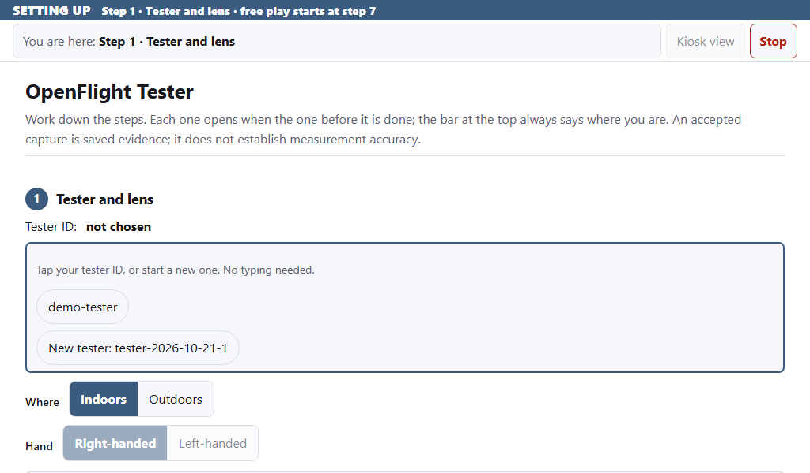 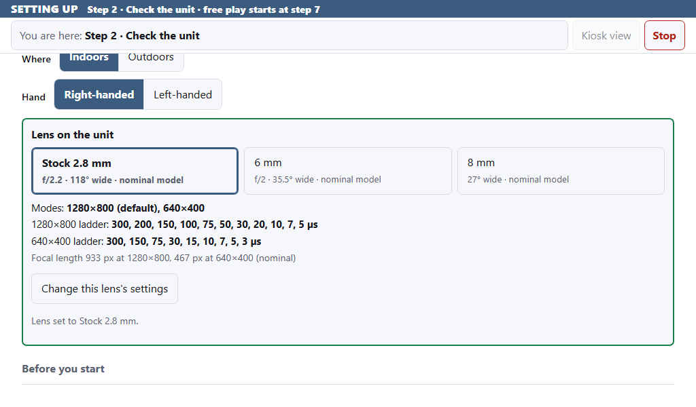

**2. Check the unit.** Three short checks, top to bottom.

- **A.** Tap **Check the unit**. All four sensors should say **ready**. If one is missing, the page names it and says what to check: fix it and tap **Check the unit** again. Tick **I pressed RESET on the ranging radar board** only if you pressed it.
- **B.** Tap **Start the tilt check**, then **lift the FRONT of the unit about 2 cm and hold it still** until the line says **Front checked. Now lift the LEFT side**. Put the front down, then lift the unit's **left side** (your left, standing behind it) about 2 cm and hold it until the line says **Left checked. Now turn the unit round**. Put it down, turn it to face the other way **on the same spot** and tap **Done: it is turned**; then turn it back and tap **Done: it is turned** again. The line turns green: **Tilt sensor checked: the front, the left and the zero**. If it says the front read the wrong way, put the unit down and tap the fix that's marked: **Turned around (180°)**, **Quarter turn left (90°)**, **Quarter turn right (90°)** or **Upside down**. The check then runs again; follow the line again.
- **C.** Tick the box to say the unit is set up as shown (on its feet on a flat floor, nothing loose, every cable in), then tap **Confirm the setup**.

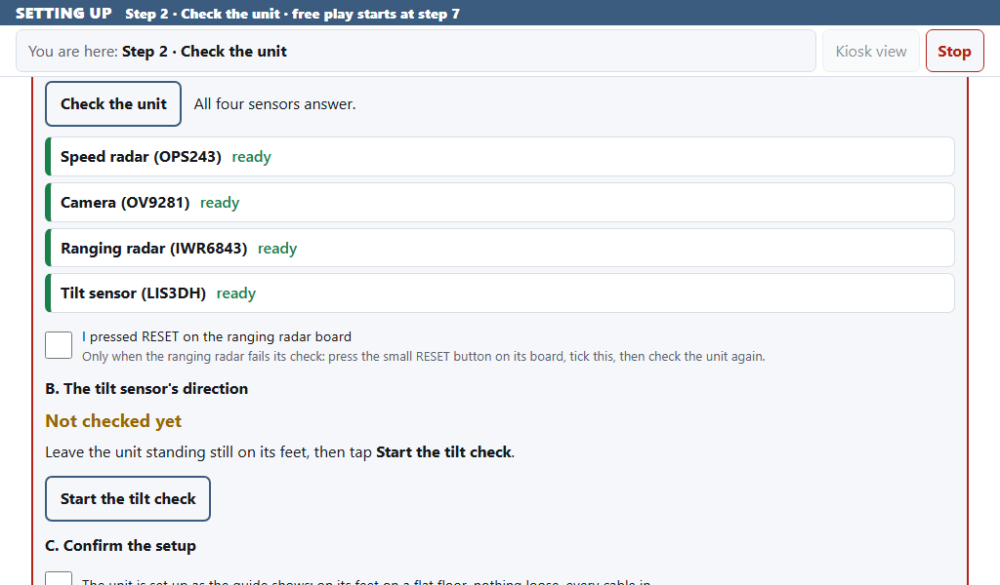 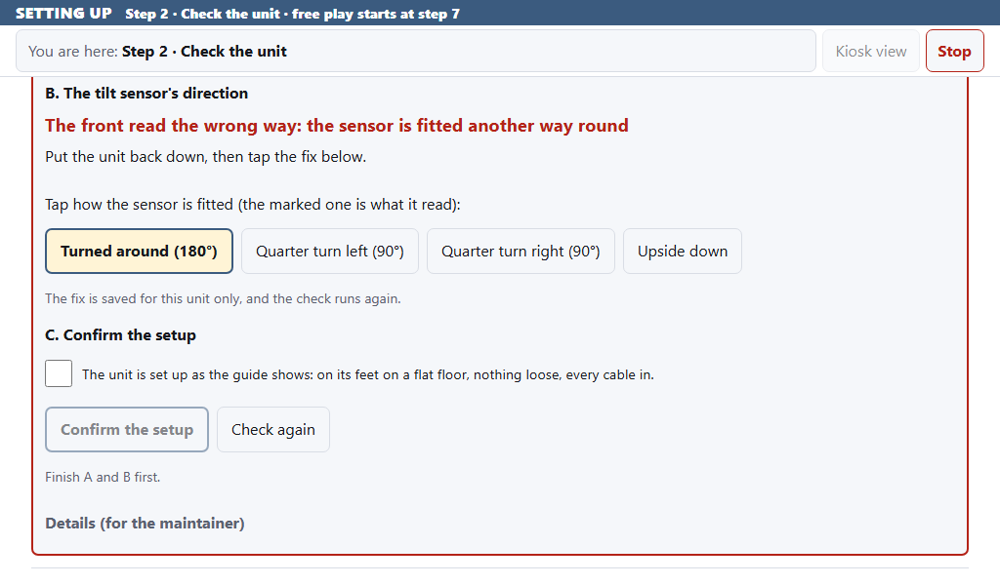

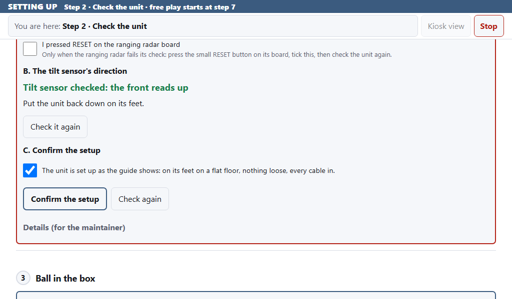

**3. Ball in the box.** Stand the unit **1.8–2.9 m (6–9.5 ft) behind the ball**, pointing down your target line. The camera opens here; if it doesn't, tap **Show the camera**. Put a ball in the **yellow box** and wait for the **green check**. Drag the **blue line** to where the floor meets your net or screen, then tap **Confirm the ball in the box**. This writes the box into your setup record (`setup.json`, in your tester folder), and the net distance from the blue line goes with it. If you leave the line, the net distance stays the 4.6 m default, labelled not measured.

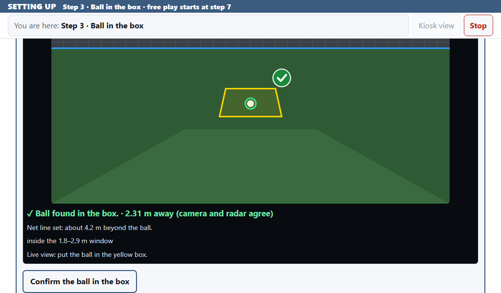

**4. Aim at your target (optional).** Drag the yellow line onto your target and tap **Confirm the aim point**. For a far target, tap **Full screen with magnifier** first. Or tap **Skip for now**. The aim is saved in the same setup record; skipping saves that too, and left and right then come from where the unit points.

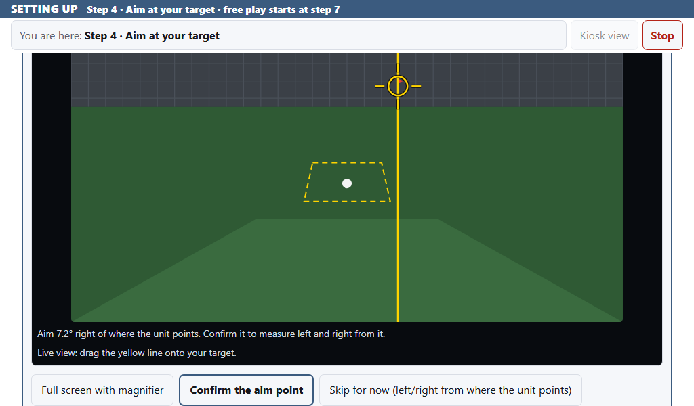

**5. Check the light.** Tap **Measure the light (both modes)** and wait for it to say **done**.

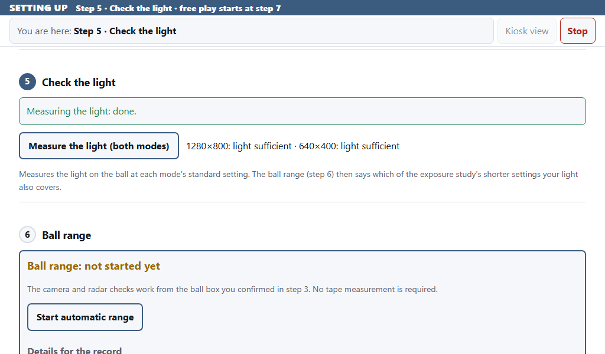

**6. Ball range.** Leave the ball in the box. The camera opens by itself; when it says **ball found and steady, tap Save the ball**, tap **Save the ball**. The step is done when it says **Ball found**; the range is saved in the setup record, from the camera, and the radar refines it on each shot. If the light note under it asks for more light, add a lamp; you can play either way.

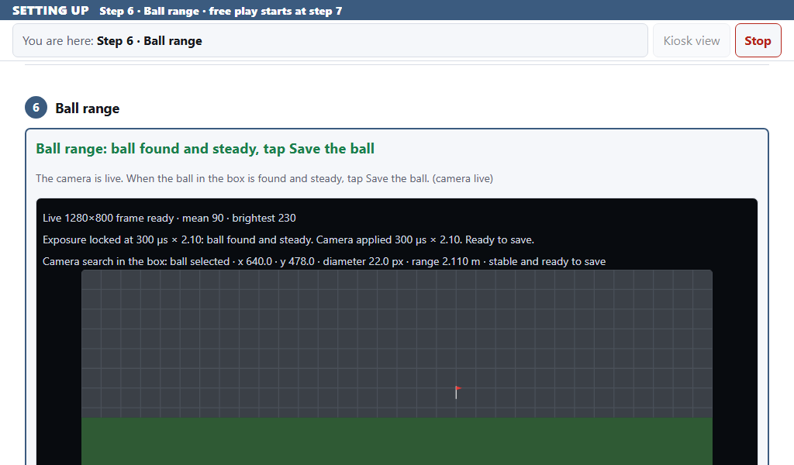 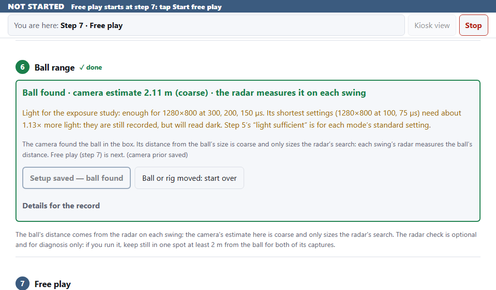

## Play

**7. Free play.** Tap the resolution you were asked to use (**1280×800** or **640×400**), tap the club you'll hit first, then tap **Start free play**. The scoreboard opens full screen on the unit. If the tester page is on the unit's own screen, that same screen switches to the scoreboard by itself once the kiosk is ready, about 20 seconds later.

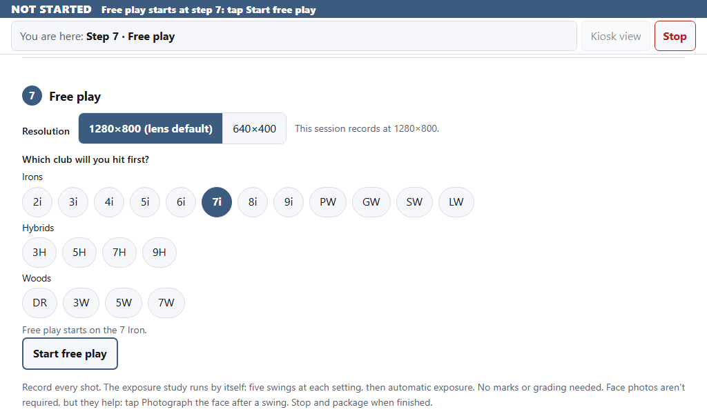

Hit balls as normal and watch your numbers. The light at the top tells you when to hit:

- **Green, SWING:** hit.
- **Amber, WAIT:** the unit is saving the last shot or changing the camera setting. Hit when it turns green.
- **Red, NOT READY:** something needs fixing, and it says what; for example, no ball in the box.

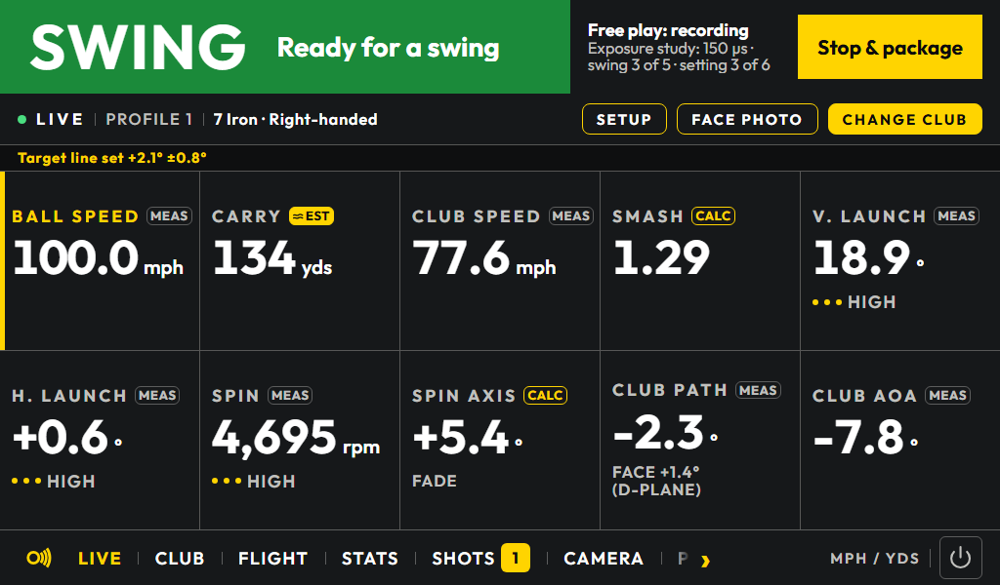

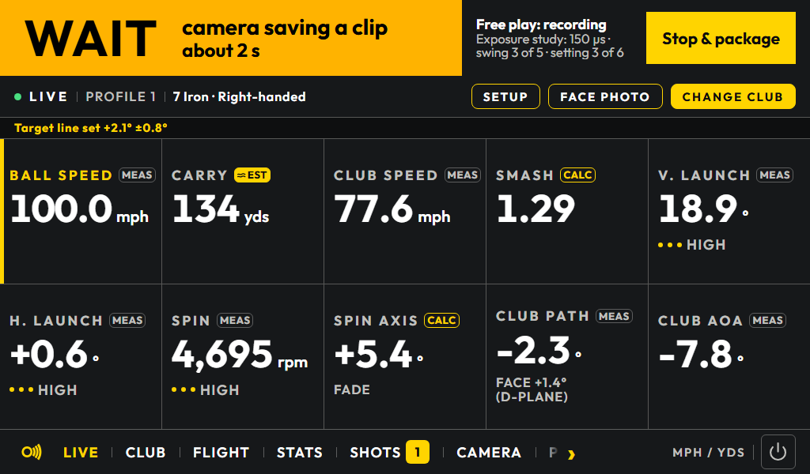 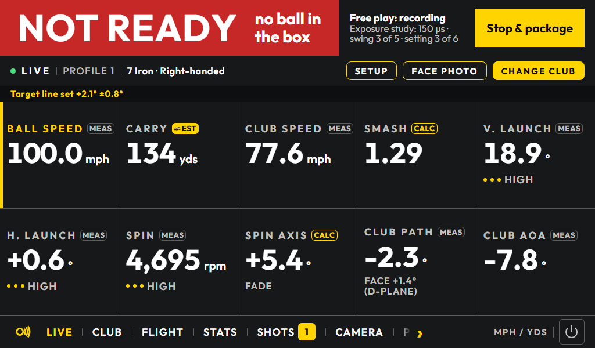

- The unit runs an exposure study by itself: five swings at each camera setting. The top right shows its progress, for example **Exposure study: 150 µs · swing 3 of 5 · setting 3 of 6**, and then **Automatic exposure** once it's done. There's nothing for you to do.
- **Switching clubs?** Tap **CHANGE CLUB** on the scoreboard before the first swing with the new club. The numbers depend on it.
- **Face photos** aren't required, but they help a lot. Before a swing you want to photograph, spray the club face with foot-powder spray (or stick on impact tape) so the strike leaves a mark. After the swing, tap **Face photo** on the scoreboard (or **Photograph the face** in step 7). The scoreboard waits; hold the club face about 0.5 m from the lens inside the dashed box, leaning the shaft back so the face looks straight at the lens, and tap **Photograph face** (or **Skip**). If the scoreboard still says WAIT, tap **Resume**. Wipe the face before spraying it again. You don't mark anything: we do that from the photo. Recommended: put a 1/4-inch white (or black) round dot sticker on the toe of each club you photograph, clear of where you hit; it makes the photo exact even at an angle.
- **To change your aim**, or get back to the tester page: tap **Tester** at the top right of the scoreboard. In step 4, tap **Move the aim point** and confirm it; the next shot is measured from the new line. Tap **Kiosk view** to return to the scoreboard.
- Labels like **EST** mark numbers we trust less. Keep hitting.
- Re-tee anywhere in the box. If you move the unit, stop, package and set up again.

## Finish and send us the data

**8. Send the package.** Tap **Stop & package** on the scoreboard (or in step 7) whenever you're done; a part-finished study is fine. Wait for **Package ready**, then tap **Done**, on the scoreboard or in step 7. On the unit's own screen, the tester page comes back by itself after **Stop & package**. Then, on the tester page, step 8:

1. Tap **Download** to save the zip on your phone or laptop. It can be about 1 GB.
2. In your Google Drive (drive.google.com), make a new folder and upload the zip into it. **Hit beside a TrackMan or another launch monitor?** Put its export (CSV) in the same folder.
3. Share the folder as "Anyone with the link".
4. Send the link to whoever asked you to test, with a sentence about your setup: indoor or outdoor, the light, **whether your enclosure is the v3 one with the experimental radar and camera mounts (and if not, which one)**, and anything odd that happened.

The zip is also saved on the unit in `~/OpenFlight-to-send/`. On the unit's own screen step 8 has no **Download** (it would only copy the zip to the same unit): open the tester page on a phone or laptop to download it (start the unit with `--host 0.0.0.0`), or copy it off with a USB stick.

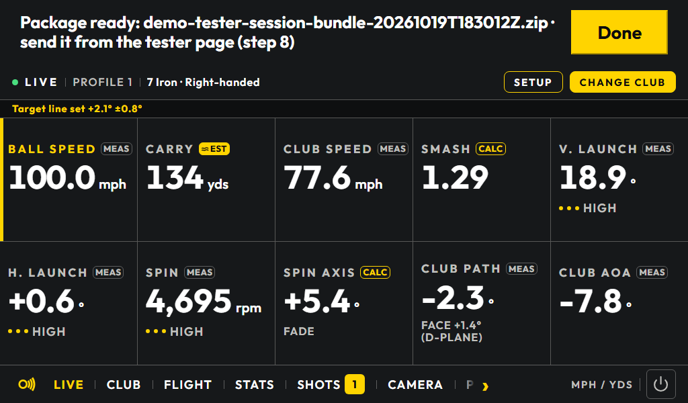 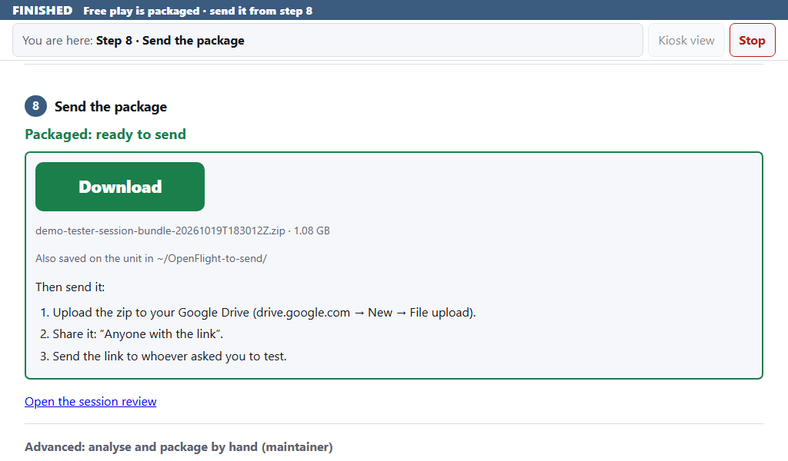

## If something goes wrong

| What you see | What to do |
|---|---|
| The tester page won't load | Check the address: a colon before `8765`, and the Pi's current address from `hostname -I`. Make sure the terminal is still running. |
| The script stops, mentioning OpenFlight's service | Run the `sudo systemctl stop openflight.service` line it prints, then start again. |
| The scoreboard fills the unit's screen and you want the tester page | Tap **Tester** at the top right of the scoreboard. No **Tester** button means the tester page isn't answering: check the terminal is still running. |
| On the unit's screen, **Start free play** seems to do nothing | The scoreboard takes about 20 seconds to start; the line under the top bar says so, and the screen switches by itself when it's ready. If the line is gone and you're still on the tester page, tap **Kiosk view**. |
| `--on-screen needs --host 127.0.0.1 or 0.0.0.0` | Use `--host 0.0.0.0` (a phone can also open the page) or leave `--host` out (only the unit's screen can). |
| **Check the unit** names a missing sensor | Do what its row says (for the camera: check the ribbon cable at both ends), then tap **Check the unit** again. For the ranging radar: press RESET on its board, tick the RESET box and check again; still failing, unplug its USB cable for 5 seconds and plug it back in. |
| The tilt check fails or reads the wrong way | Wrong way: put the unit down and tap the marked fix. **No lift seen** or **The lift was not clear**: lift the middle of the front edge about 2 cm and tap **Try again**. **No left-side lift seen**: lift the middle of the left side. **The left side read the wrong way**: if you did lift the left side, tell us (the front is still checked). **The unit did not sit the same way twice**: set it down flat on the same spot each time and tap **Try again**. Reads the unit on its side: stand it on its feet; if it already is, tell us. |
| No green check in step 3 | Move the ball inside the yellow box and put more light on it. |
| "Too dark", or "Too bright" outdoors | Add a lamp, or shade the ball area. You can keep hitting either way. |
| The light stays red | Read the reason it shows. "No ball in the box": re-tee inside the box and wait, adding light if needed. A sensor: press Ctrl+C, start the unit again and redo the setup. |
| Packaging fails | Tap **Try again** on the scoreboard. Your shots stay saved; after a restart, open **Advanced: analyse and package by hand** in step 8 and tap **Analyse, review & package**. |
| **Download** doesn't start | Use the copy on the unit in `~/OpenFlight-to-send/`: copy it off the Pi (a USB stick works) and send that. |
| Everything is frozen | Press Ctrl+C in the terminal. If that fails, run `sudo reboot`. Shots already recorded are saved. |
